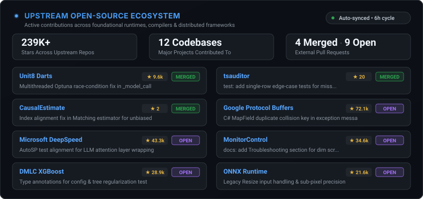

<!-- ====================== HEADER BANNER ====================== -->

  

  

<!-- ====================== SOCIAL BADGES ====================== -->

  &nbsp;
  &nbsp;
  &nbsp;
  &nbsp;
  

 

<!-- ====================== ABOUT ====================== -->
##  About Me

I am a software engineer focused on **distributed systems**, **data platforms**, and **machine learning infrastructure**. I enjoy tackling problems where correctness and runtime performance matter most: eliminating multithreaded race conditions, resolving execution graph edge cases, and building high-throughput data pipelines that remain reliable under heavy loads.

- 🎓 **M.S. Computer Science** @ **Stevens Institute of Technology** (Hoboken, NJ — GPA **3.71 / 4.0** · [Digital Degree](https://www.parchment.com/lp/award/e991230d-435f-4a4f-90e8-8809f734e43a))
- ☁️ **AWS Certified Data Engineer – Associate** ([Verify on Credly](https://www.credly.com/badges/2d86b01c-3459-4bb4-ad39-4cc492678060))
- ⚙️ **Systems & Distributed Computing**: Concurrency safety, race-condition elimination, execution graph optimization, and low-latency communication runtimes.
- 🌊 **Data Engineering & Lakehouses**: Production-grade Medallion architecture (Snowflake + dbt Core + S3), incremental loading, SCD Type 2 snapshots, and streaming pipelines (Kafka + Spark).
- 🔬 **Upstream Open-Source Engineering**: Actively resolving runtime edge cases and bugs across foundational repositories including Google Protocol Buffers, Microsoft DeepSpeed, ONNX, and PyTorch Vision.
- 🌐 **Portfolio & Architecture Write-ups** → **[ankitdhandharia.com](https://ankitdhandharia.com)**

 

---

<!-- ====================== UPSTREAM OPEN SOURCE ====================== -->
## ⚡ Upstream Open-Source Contributions

Real-time snapshot of public pull requests and upstream engineering contributions across external ecosystems, auto-updated via GitHub Actions:

  

### 🧠 Machine Learning Runtimes & Distributed Systems

- **[ONNX Reference Runtime](https://github.com/onnx/onnx)** `★ 21.6k` · 
  > Handled legacy Resize inputs in reference implementation and preserved exact nearest-neighbor sub-pixel coordinate roundings across opset 10/11 transitions.

- **[Microsoft DeepSpeed](https://github.com/deepspeedai/DeepSpeed)** `★ 43.2k` · 
  > Fixed AutoSP test suite expecting LLM decoder attention layers to be auto-wrapped with `DistributedAttention`, aligning tests with the intentional sequence parallelism operator architecture.

- **[PyTorch Vision](https://github.com/pytorch/vision)** `★ 18.0k` · 
  > Guarded reference `evaluate()` sample-count checks against uninitialized default process groups when benchmarks run in standalone non-distributed mode.

- **[DMLC XGBoost](https://github.com/dmlc/xgboost)** `★ 28.9k` · 
  > Added strict Python type annotations to config and tree regularization test suites and enabled mypy CI verification.

### 📊 Time-Series, Bayesian Optimization & Statistical Engines

- **[Unit8 Darts](https://github.com/unit8co/darts)** `★ 9.6k` ·  
  > **Merged**: Resolved multithreaded race condition where `ModelMeta.__call__` stored creation arguments in class-level attributes, preventing collisions during parallel Optuna sweeps (`n_jobs>1`). Also documented `window` parameter in `CauchyNLLScorer`.

- **[Meta BoTorch](https://github.com/meta-pytorch/botorch)** `★ 3.6k` · 
  > Introduced pluggable `cat_kernel_factory` in `MixedSingleTaskGP` to support domain-specific categorical kernels alongside continuous dimensions.

- **[AWS GluonTS](https://github.com/awslabs/gluonts)** `★ 5.2k` · 
  > Prevented unintended CUDA context initialization by enforcing CPU predictor placement when training with `accelerator="cpu"`.

- **[CausalEstimate](https://github.com/kirilklein/CausalEstimate)** ·  & **[tsauditor](https://github.com/imann128/tsauditor)** · 
  > **Merged**: Fixed unaligned DataFrame index in `Matching._compute_effect` that caused silent NaN calculations; added single-row anomaly edge-case test suites.

### 🔌 Core Protocols & Cloud Tooling

- **[Google Protocol Buffers](https://github.com/protocolbuffers/protobuf)** `★ 72.1k` · 
  > Included duplicate collision key in C# `MapField.Add` exception message to accelerate debugging in downstream cloud logging services.

- **[AWS SageMaker Python SDK](https://github.com/aws/sagemaker-python-sdk)** `★ 2.3k` · 
  > Fixed Local Container mode failure when an S3 input channel points to an individual file object instead of a prefix directory.

- **[MonitorControl](https://github.com/MonitorControl/MonitorControl)** `★ 34.5k` · 
  > Documented troubleshooting resolutions for macOS dim screen capture conflicts and slider brightness jumps.

  

 

---

<!-- ====================== FEATURED SYSTEMS ====================== -->
## 🛠 Featured Systems & Architecture

<table>
<tr>
<td width="50%" valign="top">

### 🏔 [Medallion Data Lakehouse](https://github.com/ankitdhandharia/AWS_DBT_Snowflake)
**`dbt Core` `Snowflake` `AWS S3` `Jinja`**

End-to-end cloud data warehouse implementing the **Bronze → Silver → Gold** architecture on an Airbnb dataset.
- Incremental loading + **SCD Type 2** snapshots for point-in-time dimensional accuracy
- Metadata-driven Gold layer with custom **dbt Jinja macros**
- Automated schema validation & freshness assertions — **40% compute cost cut** via incremental materialization

</td>
<td width="50%" valign="top">

### ⚡ [Autonomous Multi-Source Aggregator](https://github.com/hiringfleet/HiringFleet---Tech-Professional-Events-Aggregator)
**`TypeScript` `Node.js` `Distributed Ingestion` `APIs`**

Distributed event ingestion and normalization platform integrating 8+ external sources (Luma, Meetup, Ticketmaster, Pretalx, Devpost, Kaggle).
- Unified schema normalization and cross-platform deduplication
- Zero-auth data adapters for open-data event syndication
- Click-to-recommendation feedback loop with low-latency dispatch

</td>
</tr>
<tr>
<td width="50%" valign="top">

### 🛡 [Deterministic LLM Model Gateway](https://github.com/hiringfleet/HiringFleet-Portal-Resume-Optimizer)
**`FastAPI` `Python` `OpenRouter` `Security Guardrails`**

Multi-tier LLM gateway with deterministic model dispatch (GPT-4o-mini & DeepSeek-V3.2) and token budgeting.
- Shared daily cost/token caps across concurrent execution engines
- Defense-in-depth security guardrails mitigating SSRF, prompt injection, and DoS attacks
- Section-scoped semantic prompting for deterministic outputs

</td>
<td width="50%" valign="top">

### 🤖 [Progressive Hybrid RAG Pipeline](https://github.com/ankitdhandharia/RAG_Project)
**`LangChain` `ChromaDB` `HuggingFace` `Vector Embeddings`**

Modular Retrieval-Augmented Generation system with dense embeddings and persistent vector indexing.
- Zero cloud API dependency using local HuggingFace embeddings (384-dim)
- Persistent **ChromaDB** vector store with sub-second retrieval across 400+ page documents
- Clean OOP architecture ready for high-throughput inference

</td>
</tr>
</table>

<a href="https://github.com/ankitdhandharia?tab=repositories">→ Browse all repositories</a>

 

---

<!-- ====================== TECH STACK ====================== -->
## 🛠 Technical Toolkit

**Languages & Systems**

**Data Engineering & Big Data**

**Cloud & DevOps**

**AI / ML & Frameworks**

**Databases & Backend**

 

---

<!-- ====================== EDUCATION & CREDENTIALS ====================== -->
## 🎓 Education & Credentials

<table>
  <tr>
    <td width="50%" align="center" valign="top">
       
      
        
      <h3>Stevens Institute of Technology</h3>
      <b>M.S. in Computer Science</b> 
      Hoboken, NJ · Sep 2024 – May 2026 
      
GPA: <b>3.71 / 4.0</b>

      Distributed Systems · Machine Learning · Cloud Computing · Advanced Algorithms
        
      <a href="https://www.parchment.com/lp/award/e991230d-435f-4a4f-90e8-8809f734e43a"><b>🎓 View Digital Degree (Parchment) »</b></a>
        
    </td>
    <td width="50%" align="center" valign="top">
       
      
        
      <h3>Amazon Web Services</h3>
      <b>AWS Certified Data Engineer – Associate</b> 
      Issued by Amazon Web Services Training &amp; Certification 
      
Active Credential: <b>March 2026</b>

      <a href="https://www.credly.com/badges/2d86b01c-3459-4bb4-ad39-4cc492678060"><b>🔗 Verify on Credly »</b></a>
        
    </td>
  </tr>
</table>

 

---

<!-- ====================== GITHUB ACTIVITY ====================== -->
## 📊 GitHub Activity

  

  

 

<!-- ====================== FOOTER ====================== -->

  

  <a href="https://ankitdhandharia.com"><b>ankitdhandharia.com</b></a>

